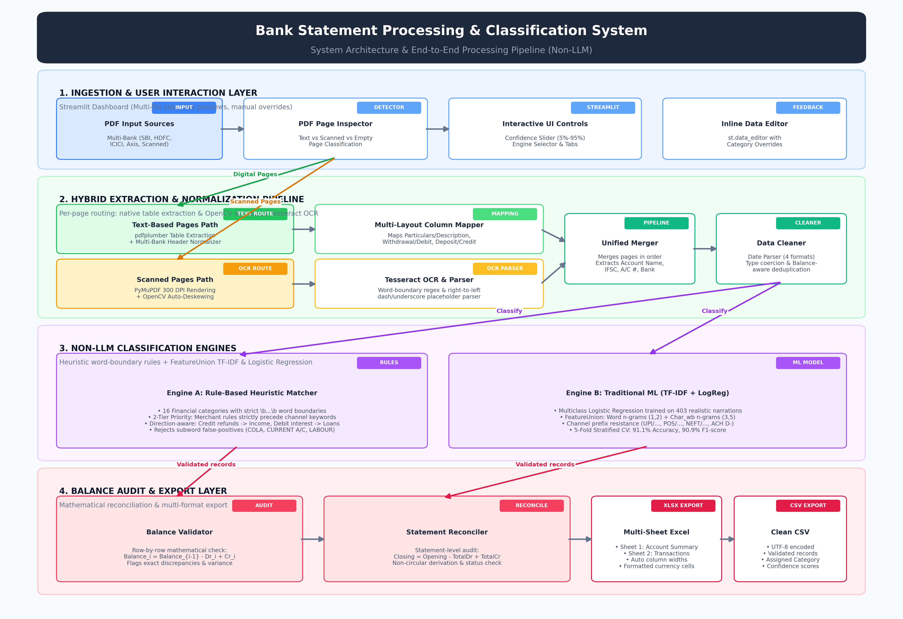

# Befree AI & Automation — Bank Statement Processing & Classification System

A robust, **Non-LLM** based Bank Statement Processing & Classification system built for the **Befree AI & Automation Internship Assessment**.

The system automates the ingestion, parsing, balance validation, categorization, and export of bank statements across multiple bank formats (including SBI, HDFC, ICICI, Axis, and generic layouts) for text-based, scanned, and mixed-mode PDFs.

---

## 🌟 Key Features

1. **Multi-Bank Format Support**:
   - Supports diverse banking layouts: standard row-by-row tables (e.g. **State Bank of India**, **ICICI Bank**, **Axis Bank**), packed multi-line table cells (e.g. **HDFC Bank**), and plain text statements.
   - Dynamic header column mapping automatically maps variations in headers (`Date`, `Particulars`/`Description`, `Debit`/`Withdrawal`, `Credit`/`Deposit`, `Balance`) into a uniform structure.
   - Extracts account metadata: Account Holder, Account Number (masked and unmasked), IFSC Code, and Bank Name.

2. **Universal Date Format Parser**:
   - Robustly parses diverse date representations:
     - `DD-MM-YYYY`, `DD/MM/YYYY`, `DD.MM.YYYY` (e.g. `01-10-2026`, `14/10/26`)
     - `YYYY-MM-DD` (e.g. `2026-10-01`)
     - `DD Mon YYYY` (e.g. `01 Oct 2026`, `14-Oct-2026`, `Oct 01, 2026`)

3. **Dual PDF Extraction & Deskew Engine**:
   - **Text-based PDFs**: High-speed native extraction using `pdfplumber` and `PyMuPDF (fitz)`.
   - **Scanned / Image-based PDFs**: 
     - **Automatic Deskewing**: Automatically estimates document skew angle via horizontal projection profile variance in OpenCV (`cv2`) and rotates tilted scans back to horizontal ($0.0^\circ$) before OCR.
     - **Image Preprocessing**: Grayscale conversion, contrast boost, and sharpening (preserving fine character details and punctuation without erosion).
     - **Resilient Right-to-Left OCR Line Parser**: Accurately recognizes OCR placeholder tokens (`_`, `—`, `–`, `-`, `~`), leverages word boundaries (`\bCR\b` vs `SUBSCRIPTION`), and uses running balance differential tracking.
   - **Mixed-Mode PDFs (Real Per-Page Routing)**:
     - Inspects each individual page independently (`inspect_pdf_pages`).
     - Digital text pages are routed through high-speed structured table extractors (`pdfplumber`).
     - Scanned image pages are rendered to 300 DPI bitmaps and processed via deskewed Tesseract OCR.
     - Results are merged in exact chronological/page order into one unified transaction DataFrame.
     - Account metadata is parsed from the combined text.
     - If Tesseract OCR is not installed, digital text pages are extracted seamlessly while identifying skipped scanned pages with a clear warning.

4. **Transaction Balance Validation & Reconciliation**:
   - **Row-by-Row Mathematical Validation**: Verifies that $\text{Balance}_i = \text{Balance}_{i-1} - \text{Debit}_i + \text{Credit}_i$. Flags discrepancies with exact variance.
   - **Statement-Level Reconciliation**: Reconciles Opening Balance, Total Debits, Total Credits, and Closing Balance without circular dependencies.
   - **Legitimate Duplicate Retention**: Preserves multiple transactions of the same amount on the same day when their running balances differ (e.g. two separate ₹450 Swiggy orders on the same day).

5. **Non-LLM Classification Engine with Confidence Scoring**:
   - **Heuristic Rule-Based Classifier**:
     - Strict word-boundary dictionary matching (`\b...\b`) covering 16 financial categories.
     - Specific merchant and category keywords strictly take precedence over generic payment-channel tokens (`UPI`, `NEFT`, `IMPS`, `RTGS`, `POS`, `ACH`, `CHQ`). E.g. `"NEFT/RENT PAYMENT"` classifies as `Rent`, `"UPI/AMAZON/ORDER"` classifies as `Shopping`, `"UPI/SWIGGY"` classifies as `Food & Dining`, `"POS/RELIANCE FRESH"` classifies as `Shopping`, and `"MOB BKG UPI PHONEPE GROCERY"` classifies as `Shopping`.
     - Direction awareness maps credit refunds/cashback to `Income` and debit interest charges to `Loans & EMI` or `Bank Charges`.
   - **Machine Learning (TF-IDF + Logistic Regression)**:
     - Multiclass classifier trained on 403 clean, diverse synthetic banking descriptions across 16 categories. Zero personal names or private records.
     - Extended with realistic Indian channel prefixes (`UPI/`, `POS/`, `NEFT/`, `IMPS/`, `ACH D-`) so the model learns merchant tokens over channel noise.
     - `FeatureUnion` combining word n-grams `(1, 2)` and character n-grams `(3, 5)` (`char_wb`).
     - **Evaluation Metrics**: Genuine 5-Fold Stratified Cross-Validation reporting **Accuracy (~91.1%)**, **Weighted Precision (~91.5%)**, **Weighted Recall (~91.1%)**, and **Weighted F1-score (~90.9%)** alongside an interactive Plotly **Confusion Matrix**.
     - Tested on held-out realistic UPI narrations with **100% test accuracy**.
   - **Confidence Threshold Slider**: Dynamically filters predictions below the selected threshold into `"Uncategorized"`.

6. **Interactive UI & Professional Data Export**:
   - **Multi-File Upload Support**: Upload single or multiple statements simultaneously (`accept_multiple_files=True`). Multi-file uploads automatically render into individual tabs with document-level analysis, reconciliation, and downloads.
   - **Manual Category Override**: Interactive `st.data_editor` in Streamlit allows users to adjust any category via a dropdown selector before downloading.
   - **Multi-Sheet Excel Export**: Outputs an **Account Summary** worksheet (metadata, totals, reconciliation audit) and a styled **Transactions** worksheet with auto-adjusted column widths.
   - **Clean CSV Export**: UTF-8 encoded CSV with all validated transaction fields.

---

## 🏗️ Architecture & Project Structure



### Directory Structure
```
BankStatementAnalyzer/
│
├── classification/
│   ├── rule_classifier.py        # Word-boundary heuristic classifier with merchant prioritization & direction awareness
│   └── ml_classifier.py          # TF-IDF (word + char_wb) + Logistic Regression with 5-fold CV metrics
│
├── extraction/
│   ├── pipeline.py               # Unified document extraction with per-page hybrid routing
│   ├── pdf_detector.py           # Per-page inspection (text, scanned, mixed) & error validation
│   ├── text_extractor.py         # Multi-bank table extractor & full narration preservation
│   ├── ocr_extractor.py          # PyMuPDF rendering + OpenCV deskewing + Tesseract OCR
│   └── transaction_parser.py     # Multi-format date & resilient OCR line parser
│
├── processing/
│   ├── data_cleaner.py           # Date standardization, type coercion & balance-aware deduplication
│   └── balance_validator.py      # Mathematical balance check & non-circular reconciliation
│
├── export/
│   └── export_data.py            # Formatted CSV and Multi-Sheet Excel (.xlsx) generator
│
├── sample_statements/            # Authentic & synthetic test statements
│   ├── sbi_sample.pdf            # State Bank of India (7-column layout, synthetic)
│   ├── hdfc_sample.pdf           # HDFC Bank (packed cell layout)
│   ├── icici_sample.pdf          # ICICI Bank (6-column layout)
│   ├── axis_sample.pdf           # Axis Bank (7-column layout)
│   ├── sample_bank_statement_text_based.pdf # 14-transaction balanced demo statement
│   └── scanned_sample.pdf        # Scanned image-based statement
│
├── tests/                        # 30 automated unit & integration tests
│   ├── test_extraction.py
│   ├── test_classification.py
│   ├── test_validation.py
│   ├── test_export.py
│   └── test_integration.py
│
├── app.py                        # Streamlit web dashboard with multi-file support & interactive editor
├── requirements.txt              # Project dependencies
└── README.md                     # Documentation
```

---

## 🚀 Setup & Installation Instructions

### 1. Prerequisites
- **Python**: Version `3.10+` (Tested on Python `3.12`)
- **Tesseract OCR** (Required for scanned image-based statements):
  - **Windows**: Download and install from [UB-Mannheim Tesseract](https://github.com/UB-Mannheim/tesseract/wiki).
  - **Ubuntu / Debian**: `sudo apt-get install tesseract-ocr`
  - **macOS**: `brew install tesseract`

### 2. Activate Virtual Environment
On Windows PowerShell:
```powershell
Set-ExecutionPolicy -Scope Process -ExecutionPolicy Bypass
.\.venv\Scripts\Activate.ps1
```

### 3. Install Python Dependencies
```bash
cd BankStatementAnalyzer
pip install -r requirements.txt
```

---

## 🖥️ Running the Web Application

Launch the Streamlit interactive dashboard:
```bash
cd BankStatementAnalyzer
streamlit run app.py
```
Open your browser at **`http://localhost:8501`**.

### Usage Steps:
1. Upload one or more bank statement PDFs (SBI, HDFC, ICICI, Axis, scanned, or mixed statements).
2. If multiple statements are uploaded, navigate between files using the document tabs.
3. Choose your preferred **Classification Engine** (Rule-Based or Machine Learning) in the sidebar.
4. Adjust the **Confidence Threshold** slider.
5. Review extracted **Account Metadata**, **Balance Reconciliation Audit**, and **Transaction Table**.
6. Optionally click on any category in the table to **manually override** it.
7. Explore interactive charts (Expense Breakdown by Category and Daily Cash Flow).
8. Download verified results as **CSV** or multi-sheet **Excel**.

---

## 🧪 Running the Test Suite

Execute the automated test suite using `pytest`:
```bash
cd BankStatementAnalyzer
python -m pytest tests/ -v
```

All 30 unit and integration tests verify:
- ✅ Account details extraction across multiple bank layouts (SBI, HDFC, ICICI, Axis, Generic)
- ✅ Standard table and packed multi-line table extraction (SBI, HDFC, ICICI, Axis)
- ✅ Multi-format date parsing (`01 Oct 2026`, `2026-10-01`, `01-10-2026`)
- ✅ Full transaction narration preservation without truncation
- ✅ Dash and underscore placeholder handling (`_`, `—`, `–`, `-`) in Debit/Credit columns
- ✅ Legitimate duplicate preservation (same day, same amount, different balance)
- ✅ Word-boundary rule matching (preventing `COLA`, `CURRENT ACCOUNT`, `LABOUR CHARGES` bugs)
- ✅ Merchant/Category keyword priority over channel prefixes (`NEFT/RENT PAYMENT` $\to$ Rent, `UPI/AMAZON/ORDER` $\to$ Shopping)
- ✅ Direction-aware classification (`INTEREST PAID ON HOME LOAN` $\to$ Loans & EMI, credit refunds $\to$ Income)
- ✅ Mathematical running balance validation & discrepancy detection
- ✅ Non-circular statement summary reconciliation
- ✅ OpenCV deskewing on tilted/rotated scanned PDFs (tested with deliberate 2.0° tilt)
- ✅ Per-page hybrid routing on 3-page mixed PDFs (digital text + scanned OCR)
- ✅ ML evaluation metrics (91.1% Accuracy, 90.9% F1-score, Confusion Matrix)
- ✅ ML generalization on held-out UPI narrations (100% accuracy)
- ✅ Multi-sheet Excel workbook generation with Account Summary

---

## 📊 Classification Categories (16 Unified Classes)
1. **Food & Dining** (Zomato, Swiggy, cafes, restaurants, bakeries)
2. **Shopping** (Amazon, Flipkart, D-Mart, Reliance Fresh, Zepto, Blinkit, retail)
3. **Transportation** (Uber, Ola, Rapido, IRCTC, airlines, metro)
4. **Fuel** (Shell, HPCL, BPCL, IOCL, petrol pumps, FASTag tolls)
5. **Utilities** (Electricity, broadband, mobile, piped gas, water)
6. **Entertainment** (Netflix, Spotify, BookMyShow, Hotstar, gaming)
7. **Healthcare** (Pharmacies, diagnostic labs, hospitals, clinics)
8. **Loans & EMI** (Home loans, car loans, personal loans, finance EMIs)
9. **Insurance** (LIC, Star Health, HDFC Life, insurance premiums)
10. **Taxes** (Income tax, GST, advance tax, challan 280, municipal tax)
11. **Investment** (Mutual funds, SIP, stocks, demat, gold bonds, PPF)
12. **Rent** (House rent, maintenance, office leases)
13. **Bank Charges** (SMS alerts, annual card fees, minimum balance penalties)
14. **ATM Withdrawal** (Cash withdrawals)
15. **Transfers** (UPI, NEFT, IMPS, RTGS, wallet transfers)
16. **Income** (Salary, interest credit, dividends, refunds, bonuses)
*(Low-confidence predictions route to **Uncategorized**)*
